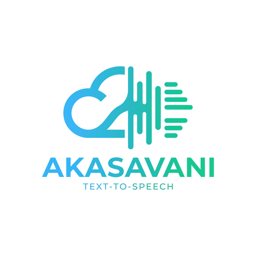

<p align="center">
  
</p>

<h1 align="center">Akasavani</h1>

<p align="center"><strong>आकाशवाणी</strong> — <em>“voice from the sky.”</em></p>

A friendly, **local** text-to-speech studio built on [Coqui TTS](https://github.com/idiap/coqui-ai-TTS).
Type your text, pick a voice, set the **speed from 0 to 3×**, and hear it — all on your own machine.
No cloud, no API keys, no per-character fees.

<p>
  
  
  
  
</p>

> **Live showcase:** https://vvsnmurthy3758.github.io/akasavani/
> (The site is a static showcase with audio samples — the model runs locally, since static hosting can't run a neural network.)

---

## ✨ Features

- **🎚️ Speed control (0–3×)** — slow down fast talkers or speed up long reads. Maps to the model's length scale, so it works for VITS *and* XTTS.
- **🗣️ English & తెలుగు (Telugu)** — a curated set of English voices from `tts_models/en/vctk/vits`, plus native **Telugu** synthesis, picked from a single dropdown. Set `AKASAVANI_ALL_SPEAKERS=1` to unlock all ~109 English voices.
- **🖱️ One double-click** (Windows) — `Start Web UI.bat` starts the server and opens your browser.
- **🔒 100% local** — your text never leaves your machine.
- **🧩 REST API** — includes an OpenAI-compatible `/v1/audio/speech` endpoint for scripting.
- **🐳 Docker ready** — `Dockerfile` + `docker-compose.yml` for reproducible runs on any OS.

---

## 🚀 Quick start

### Option A — Windows (easiest)

1. Get the code (download the ZIP or `git clone`).
2. Double-click **`Start Web UI.bat`**.
3. Your browser opens at <http://localhost:5002>. Type, choose a voice, move the **Speed** slider, click **Speak**.

> First run downloads the voice model (~150 MB). Later runs start fast.

### Option B — Any OS (Python 3.11)

```bash
git clone https://github.com/vvsnmurthy3758/akasavani.git
cd akasavani
python -m venv .venv
# Windows: .venv\Scripts\activate
source .venv/bin/activate
pip install -r requirements.txt
# install espeak-ng (required by the vctk/vits model), e.g.:
#   Windows: winget install eSpeak-NG.eSpeak-NG
#   Debian/Ubuntu: sudo apt-get install espeak-ng
tts-server --model_name tts_models/en/vctk/vits --port 5002
```

Then open <http://localhost:5002>.

> For an NVIDIA GPU, install PyTorch from the CUDA index instead:
> `pip install torch==2.4.1 torchaudio==2.4.1 --index-url https://download.pytorch.org/whl/cu121`

### Option C — Docker

```bash
docker compose up --build
```

Open <http://localhost:5002>. To use a GPU, uncomment the `deploy:` block in `docker-compose.yml`.

---

## 🎚️ The speed slider

The web UI has a **Speed** slider under the text box:

| Value | Meaning |
|-------|---------|
| `0`   | slowest (clamped to a safe `0.1×`) |
| `1`   | normal |
| `3`   | fastest |

The chosen value is sent to the server as `speed`. For models that don't accept `speed` directly (like VITS), the server temporarily scales the model's `length_scale`, so the effect is smooth and pitch stays natural.

**How it's wired:** the slider lives in two files inside the installed `coqui-tts` package (`server.py` and `templates/index.html`). Because a reinstall would overwrite them, patched copies are kept in [`patches/`](patches) and re-applied automatically by `start_webui.py` on every launch (and by `docker-entrypoint.sh` in Docker).

---

## 🗣️ English & తెలుగు (Telugu)

The web UI has a **Language** dropdown:

| Language | Engine | Notes |
|----------|--------|-------|
| English | Coqui `tts_models/en/vctk/vits` | 10 curated voices (all ~109 with `AKASAVANI_ALL_SPEAKERS=1`) |
| తెలుగు (Telugu) | `facebook/mms-tts-tel` | Single voice, ~145 MB, no login required |

> **Why a second engine?** Coqui's model zoo has **no Telugu model**, so Telugu is
> served by a small backend in [`patches/telugu_tts.py`](patches/telugu_tts.py) that
> runs on Hugging Face `transformers`. The first Telugu request downloads the voice
> (~145 MB); after that it is fully offline. The speed slider works for Telugu too.

### Optional: the IndicF5 engine (best quality)

[`ai4bharat/IndicF5`](https://huggingface.co/ai4bharat/IndicF5) produces the most
natural Telugu, but it is a **gated** voice-cloning model and needs a reference clip:

1. Log in to Hugging Face and **accept the terms** at <https://huggingface.co/ai4bharat/IndicF5>.
2. Run `huggingface-cli login` (or set the `HF_TOKEN` environment variable).
3. Point the app at a short Telugu clip and its exact transcript:

   ```bat
   set AKASAVANI_TELUGU_ENGINE=indicf5
   set INDICF5_REF_AUDIO=C:\path\to\telugu_reference.wav
   set INDICF5_REF_TEXT=మీ రిఫరెన్స్ ఆడియోలో ఉన్న వాక్యం
   ```

4. Restart the UI.

With `AKASAVANI_TELUGU_ENGINE=auto` (the default), Akasavani uses IndicF5 whenever a
reference clip, its transcript **and** a Hugging Face token are all present, and
otherwise falls back to the always-available MMS voice.

---

## 🧩 REST API

Beyond the web UI, the server exposes an OpenAI-compatible endpoint:

```bash
curl -X POST http://localhost:5002/v1/audio/speech \
  -H "Content-Type: application/json" \
  -d '{"input":"Hello world","voice":"p225","speed":1.5,"response_format":"wav"}' \
  --output hello.wav
```

Supported `response_format`: `wav`, `mp3`, `opus`, `aac`, `flac`, `pcm`.

Add `"language": "te"` to speak Telugu (default is `"en"`).

---

## 📁 Project layout

```
├── Start Web UI.bat        # Windows one-click launcher
├── start_webui.py          # starts server, waits, opens browser, applies patch
├── speak.py                # small command-line TTS helper
├── patches/                # patched server.py + index.html (speed slider) + telugu_tts.py
├── docs/                   # GitHub Pages landing site (+ demo audio)
├── Dockerfile              # container image
├── docker-compose.yml
├── requirements.txt
└── .github/workflows/ci.yml
```

---

## 🛠️ Configuration

Copy `.env.example` to `.env` and adjust:

| Variable | Default | Meaning |
|----------|---------|---------|
| `MODEL_NAME` | `tts_models/en/vctk/vits` | Coqui model to load |
| `PORT` | `5002` | HTTP port |
| `COQUI_TOS_AGREED` | `1` | Accept Coqui model terms (required non-interactively) |
| `AKASAVANI_TELUGU` | `1` | Enable the Telugu option in the UI |
| `AKASAVANI_TELUGU_ENGINE` | `auto` | `auto`, `mms` or `indicf5` |
| `AKASAVANI_ALL_SPEAKERS` | *(unset)* | `1` shows all ~109 English voices |
| `INDICF5_REF_AUDIO` | *(unset)* | Reference clip for the IndicF5 engine |
| `INDICF5_REF_TEXT` | *(unset)* | Transcript of that reference clip |

---

## 📜 Licenses & credits

- **This project:** MPL-2.0 — see [LICENSE](LICENSE).
- **Coqui TTS code:** MPL-2.0, maintained fork by the Idiap Research Institute (`idiap/coqui-ai-TTS`).
- **`vctk/vits` model:** Apache-2.0 (commercial use OK).
- **MMS-TTS Telugu** (`facebook/mms-tts-tel`): CC-BY-NC-4.0 (non-commercial).
- **IndicF5** (optional Telugu engine): MIT.
- **XTTS-v2** (if you add voice cloning): non-commercial only (Coqui Public Model License).
- The files in `patches/` are modified from Coqui TTS and remain under MPL-2.0.

---

## 🙏 Acknowledgements

Built on the excellent [Coqui TTS](https://github.com/idiap/coqui-ai-TTS) project and its community fork.
